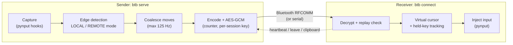

# BTBorders

Share one mouse and keyboard between two computers over Bluetooth. Encrypted pairing, no Wi-Fi needed.

[](https://github.com/NSK-394/btborders/actions/workflows/ci.yml)

[](LICENSE)


Push the cursor off the edge of computer A's screen and it appears on computer B. Typing follows
the cursor, and copied text follows too.

## Why

Our Wi-Fi network blocked device-to-device connections, so tools that share a mouse and keyboard
over the local network could not reach the other computer. Both computers had Bluetooth, though,
and a direct Bluetooth link does not depend on the router at all. So BTBorders sends input over a
Bluetooth RFCOMM link instead, and encrypts it end to end because the data is literally keystrokes.

## Features

Everything below is implemented and covered by the test suite.

* **Edge switching** on any side of the sender's screen (`left`, `right`, `top`, `bottom`). The
  cursor enters the other screen at the proportional position along that edge.
* **Relative mouse movement** with cursor parking, so different resolutions just work. Clicks,
  scroll wheel and keyboard are forwarded.
* **Encrypted and authenticated link**: AES-256-GCM on every frame, per-session keys derived with
  HKDF-SHA256, and a strictly increasing counter that rejects replayed or reordered frames.
* **Pairing code** with a built-in checksum (optional QR code with `pip install ".[qr]"`).
* **Clipboard text sync** (up to 64 KB) when the cursor crosses.
* **Emergency hotkey Ctrl+Alt+Q** returns control to the sender instantly. Control also returns
  automatically if no heartbeat arrives for 2 seconds. Held keys and buttons are always released.
* **Transports**: Bluetooth RFCOMM sockets, serial ports (Windows Bluetooth COM ports,
  `/dev/rfcomm0`) as a fallback, and TCP loopback for testing.
* **`btb devices`** lists paired Bluetooth devices on Windows, Linux and macOS.
* **Live terminal UI** (link state, latency, who has the input) and a **`btb test-loopback`**
  self-test that runs the full sender and receiver on one machine.

## How it works



```
btborders/
  core/protocol.py   packet types and struct codecs
  core/crypto.py     PSK and pairing code, HKDF key schedule, AES-GCM session (counter, replay checks)
  core/transport.py  length-prefixed frames over TCP loopback / Bluetooth RFCOMM / serial
  core/channel.py    transport + handshake + crypto + codec = SecureChannel
  core/edge.py       edge detection, proportional mapping, receiver-side virtual cursor
  core/coalesce.py   125 Hz mouse-move coalescer
  pynput_backend.py  real capture and injection (Windows hooks, X11, macOS)
  server.py          sender engine (modes, hotkey, watchdog)
  client.py          receiver engine (virtual cursor, release-all, watchdog)
  discovery.py       list paired Bluetooth devices per OS
  config.py  ui.py  cli.py  selftest.py
```

Design choices that matter:

* **Hooks never touch the network.** Capture callbacks only enqueue packets and a writer thread
  sends them, so a stalled Bluetooth link cannot freeze your local input or the emergency hotkey.
* **Cursor parking.** In remote mode the sender measures the delta from screen centre and warps the
  cursor back, so movement never runs into a screen edge.
* **Layout-independent keys.** Keys travel as names (`char:a`, `key:ctrl_l`). The raw virtual-key
  code is used only when both computers run the same OS, so shortcuts like Ctrl+C still work there.

## Quick start

Needs Python 3.11+ on both computers (or the Windows single exe below).

```bash
git clone https://github.com/NSK-394/btborders && cd btborders
uv sync                  # or: pip install .
uv run btb --help        # or just: btb --help   (after pip install)
uv run btb test-loopback # one-machine self-test, ends with ALL CHECKS PASSED
```

Linux also needs a clipboard tool for clipboard sync: `sudo apt install xclip` (or `xsel`).

The computer with the physical mouse and keyboard is the **sender** (`btb serve`). The other one is
the **receiver** (`btb connect`).

**1. Pair the computers in the OS Bluetooth settings** (once).
Windows: Settings > Bluetooth & devices > Add device. Linux: `bluetoothctl`, then
`power on`, `agent on`, `scan on`, `pair <MAC>`, `trust <MAC>`.

**2. Pair BTBorders** (once). This creates the shared secret.

```bash
# sender: creates the key, shows a pairing code, lets you pick the receiver from paired devices
btb pair --edge right        # which side of the SENDER's screen the receiver sits on

# receiver: type in the code from the sender, then pick the sender in the device menu
btb pair --code ABCD-EFGH-...
```

Other `pair` options: `--new` (replace an existing key), `--mac AA:BB:CC:DD:EE:FF` (skip the device
menu), `--no-pick` (no menu at all). `btb devices` lists paired devices and their MACs.

**3. Run.**

```bash
btb serve      # on the sender
btb connect    # on the receiver (retries with backoff until the sender is up)
```

Wait for **connected** on both, then slide the cursor off the configured edge. Slide back over the
opposite edge on the receiver to return, or press **Ctrl+Alt+Q** on the sender at any time.
Ctrl+C quits.

Per-run overrides for `serve` and `connect`: `--transport {bluetooth,serial,tcp}`, `--mac`,
`--channel` (RFCOMM 1-30, default 4), `--serial-port`, `--edge`, `--no-ui` (plain logs), `-v`.
`btb status` shows the config and the state of a running instance.

### Configuration

`btb pair` writes `config.toml` and `pairing.key` to `%APPDATA%\btborders` (Windows),
`~/.config/btborders` (Linux) or `~/Library/Application Support/btborders` (macOS). Set `BTB_HOME`
to use another folder.

```toml
[peer]
mac = "AA:BB:CC:DD:EE:FF"
[transport]
kind = "bluetooth"          # bluetooth | serial | tcp (tcp = testing only)
rfcomm_channel = 4
serial_port = ""
[layout]
receiver_edge = "right"     # side of the SENDER's screen where the receiver sits
[hotkeys]
return_local = "ctrl+alt+q"
[security]
key_file = ""               # default: <config dir>/pairing.key
```

## Windows single exe (btb.exe)

`btb.exe` runs without Python installed. Build it yourself (see [build.md](build.md)):

```powershell
uv sync
uv run pyinstaller --onefile --name btb --collect-submodules pynput btb_entry.py --noconfirm
.\dist\btb.exe test-loopback
```

Then copy `dist\btb.exe` to the other computer and use it exactly like `btb` above
(`btb.exe pair`, `btb.exe serve`, ...).

A prebuilt `btb.exe` may be attached to a GitHub release with its SHA256 checksum. It is not code
signed, and it installs global keyboard and mouse hooks, so antivirus tools may warn about it.
Building from source is the safer path.

## Security model

This program turns bytes from a radio link into keystrokes on your computer. Anyone who could
inject packets could type commands as you. Security is the core of the design, not an extra.

* **Shared-secret pairing.** `btb pair` generates a 256-bit key with the OS random generator. It is
  moved to the second computer by typing a short code (base32 with a checksum). The key never goes
  over the air. Bluetooth OS pairing is treated only as transport, not as trust.
* **Per-session keys.** Each side sends a random 16-byte nonce, and keys are derived with
  HKDF-SHA256 from the shared key and both nonces, one key per direction. Recordings of an old
  session cannot be replayed into a new one, and packets cannot be reflected back at the sender.
* **AES-256-GCM on every frame.** The frame counter is both the GCM nonce and authenticated data.
  The receiver requires a strictly increasing counter, so replayed, reordered or modified frames are
  rejected.
* **Unauthenticated peers are dropped.** A new connection must complete the encrypted handshake
  within 5 seconds or it is closed. Before that, only tiny frames (64 bytes max) are accepted, so a
  stranger cannot make it allocate memory. Any later authentication failure ends the connection and
  returns control to the local machine.
* **Defence in depth on the receiver.** Input is ignored unless the sender has switched control to
  it, clipboard size is capped at 64 KB, and every held key and button is released when control ends.
* **Fail-safe.** Ctrl+Alt+Q, a missed heartbeat (2 s), a dropped link or exiting the program all
  restore local input.
* **At rest.** `pairing.key` is created owner-only (`0600`) on Linux and macOS. On Windows it inherits
  your user profile permissions. Treat it like an SSH private key. If it leaks, run `btb pair --new`.

What it does **not** protect against:

* Someone who has your `pairing.key` can connect as your other computer and decrypt sessions they record.
* A nearby attacker can jam the radio or occupy the single connection slot (denial of service). The
  5 second handshake timeout limits the second case.
* A compromised receiver sees everything you type while the cursor is on it.
* Copied text (including passwords) is sent to the other computer when you switch. It is encrypted
  in transit but ends up on that computer's clipboard.
* The code has not had an independent security audit.

Found a problem? See [SECURITY.md](SECURITY.md) for private reporting.

## Tested platforms

Real two-computer tests over Bluetooth:

| Sender / receiver | Status |
|---|---|
| Windows to Windows | Tested |
| Linux (X11) to Windows | Tested |
| Windows to Linux (X11) | Tested |
| Linux (X11) to Linux (X11) | Tested |
| Linux on Wayland | Not supported (detected and refused, see limitations) |
| macOS | Untested. Code paths exist (`system_profiler` discovery, pynput event taps) but have not been run on real hardware |

The automated test suite runs on Windows and Ubuntu with Python 3.11 and 3.12 in CI.

## Known limitations

* **Elevated windows on Windows ignore injected input** (UIPI). Apps running as administrator,
  Task Manager and UAC prompts on the receiver will not react. Run `btb connect` from an elevated
  terminal to control them. The lock screen and Ctrl+Alt+Del screen cannot be controlled at all.
* **Wayland** does not allow normal apps to capture or inject global input. Use an Xorg/X11 session.
* **Bluetooth latency** is higher and less steady than wired or Wi-Fi links, and drops with
  distance, obstacles and Bluetooth audio sharing the radio.
* **Clipboard is text only** (max 64 KB). No files or images.
* Only the **primary monitor** is used for edge detection, and only **one peer** at a time.

## Troubleshooting

| Symptom | Likely cause and fix |
|---|---|
| `btb` is not recognized | The virtual environment is not active. Use `uv run btb ...`, activate `.venv`, or add Python's `Scripts` folder to PATH after `pip install .`. |
| `cannot listen on RFCOMM channel 4` | Bluetooth radio is off, there is no adapter, or the channel is busy. Turn Bluetooth on, or try `--channel 5` on both sides. |
| Receiver keeps printing "retry in ...s" | Sender not running yet, OS pairing missing, wrong `peer.mac`, or different `--channel` values. Check `btb devices` and `btb status`. |
| "rejected peer" or "handshake failed" | The two computers have different pairing keys. Run `btb pair --new` on the sender and `btb pair --code ...` on the receiver. |
| RFCOMM sockets fail on your setup | Use the serial fallback. Windows: Settings > Bluetooth > More Bluetooth settings > COM Ports > Add. Linux: `sudo rfcomm bind 0 <MAC> 4` creates `/dev/rfcomm0`. Then `btb serve --transport serial --serial-port COM5` and `btb connect --transport serial --serial-port COM6`. Encryption is the same on every transport. |
| Cursor reaches the edge but nothing happens | Receiver not connected yet, wrong `--edge`, or on multi-monitor the edge is the primary monitor's edge. |
| Clicks or keys ignored in some receiver windows | Those windows are elevated. Run `btb connect` as administrator. |
| Laggy cursor | Move closer, stop Bluetooth audio streaming, and check the latency shown in the UI. |
| Stuck modifier key | Press Ctrl+Alt+Q, then tap the key. Please report it. |
| Linux: nothing is captured | You are on Wayland. Log in with an Xorg/X11 session. |
| Linux: `Xlib.error` or no DISPLAY | Run inside the graphical session, not over plain SSH. |
| Need more detail | `btb serve --no-ui -v` prints log lines instead of the UI. |

## Roadmap

1. **BLE transport**: Bluetooth Low Energy for lower power and faster reconnects.
2. **Android trackpad client**: use a phone as a trackpad and keyboard with the same encrypted protocol.
3. **File transfer fallback**: negotiate over Bluetooth and move large files over a faster link when one is available.
4. **Linux and macOS validation**: macOS testing on real hardware, and an evdev/uinput backend so Wayland can work.

Also planned: multi-monitor layouts and SDP service registration.

## Development

```bash
uv sync
uv run pytest            # protocol, crypto, edge, coalescing, transports, CLI, end-to-end
uv run btb test-loopback
```

Tests never install real hooks or inject real input. The end-to-end tests run the sender and
receiver over the TCP loopback transport with mock input devices.

## Contributing and license

Contributions are welcome, see [CONTRIBUTING.md](CONTRIBUTING.md). Security issues go through
[SECURITY.md](SECURITY.md). Released under the [MIT License](LICENSE).
